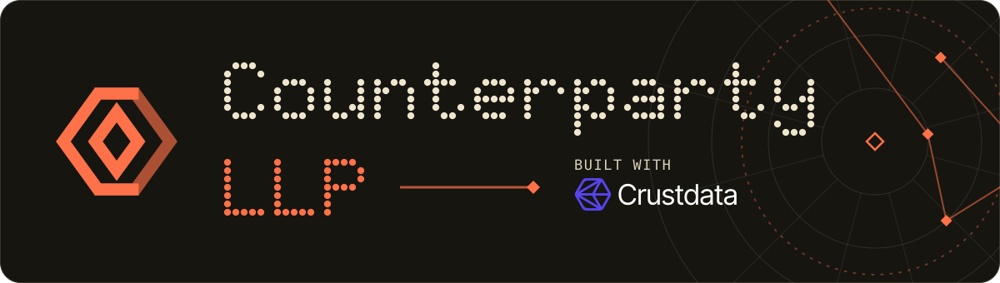
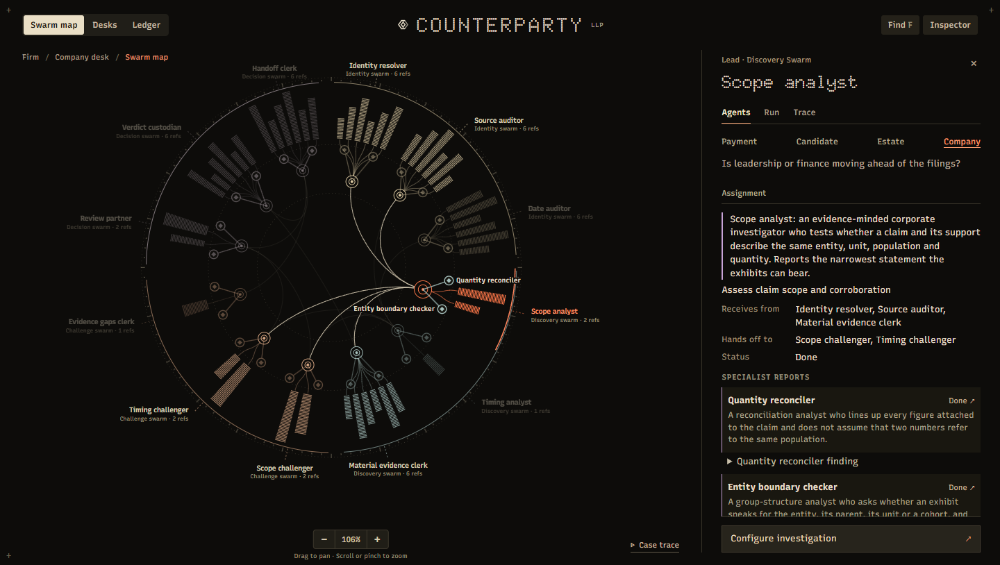
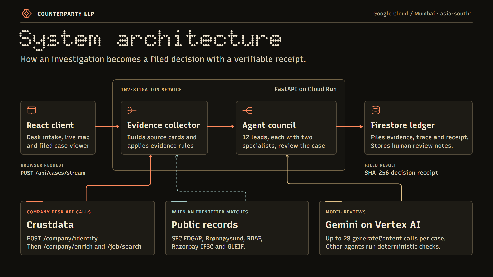
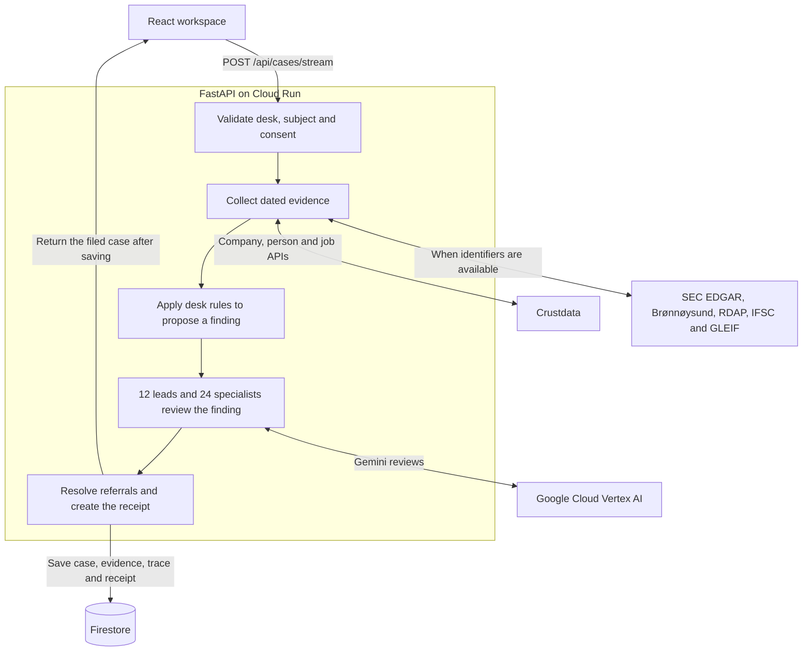
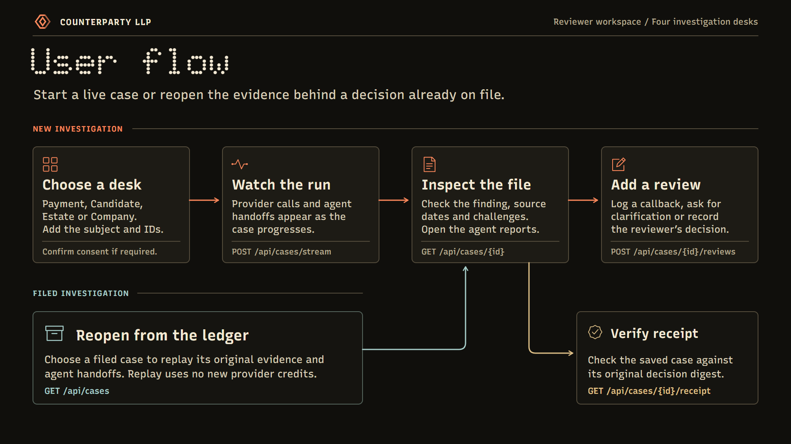
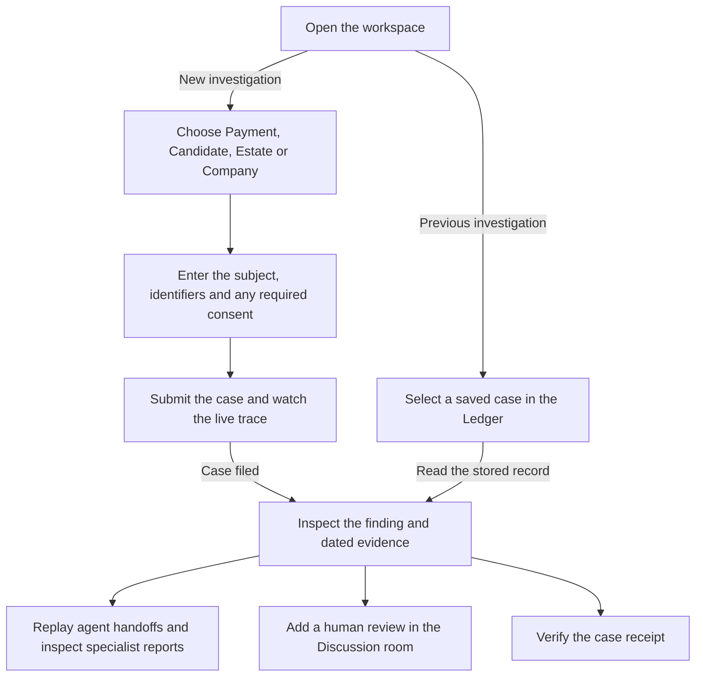

# 

**Built for ContextCon 05, the Crustdata hackathon at BITS Pilani.** Counterparty LLP helps a reviewer answer questions like “Does the person requesting new bank details still work for our vendor?” It brings dated Crustdata observations and independent records into one case file, with source cards for the reviewer to inspect. [Hackathon details](https://contextcon-bitspilani.com/)

**[Open the workspace](https://counterparty-939419364980.asia-south1.run.app/)** · **[Replay a completed investigation](https://counterparty-939419364980.asia-south1.run.app/?case=c4b983b065f7413daaf908c9ab06f9a6#swarm)** · [Run locally](#run-locally)

| [System architecture](#system-architecture) | [User flow](#user-flow) |
| --- | --- |
| Trace an investigation through FastAPI, Crustdata, Vertex AI and Firestore. | Follow a reviewer from desk intake through the live trace, case file and human review. |

[Investor pitch](docs/investor-pitch.md) · [Hinglish pitch aur team guide](docs/investor-pitch-hinglish.md) · [Buyer pitch, feature guide and live API status](docs/sales-guide.md)

[Watch the narrated Payment desk walkthrough (2:28)](docs/Counterparty-Live-Walkthrough.mp4) · [Open the case from the video](https://counterparty-939419364980.asia-south1.run.app/?case=502f0fdef9ed4e6081881ff25b39c118#swarm) · [Presenter script and input fields](docs/Counterparty-Recording-Script.docx)

The replay opens a real company investigation without spending provider credits. Select **Scope analyst** on the map to see what its two specialists checked and which evidence they cited.

[](https://counterparty-939419364980.asia-south1.run.app/?case=c4b983b065f7413daaf908c9ab06f9a6#swarm)

## System architecture



<details>
<summary>Explore the system architecture in Mermaid</summary>



</details>

[Architecture guide and API endpoints](docs/system-architecture.md) · [Full-size presentation image](docs/diagrams/system-architecture.png)

## User flow



<details>
<summary>Explore the user flow in Mermaid</summary>



</details>

[User flow guide and screen-by-screen walkthrough](docs/user-flow.md) · [Full-size presentation image](docs/diagrams/user-flow.png)

## 

A company investigation begins with **Crustdata Company Identify**. A unique, confident match lets the desk enrich the company and search its indexed job postings. For a candidate who consents, the desk can also retrieve employment history and check dates against an employer-specific colleague search. The case preserves source labels, observation dates and reported credit usage. [Crustdata API documentation](https://docs.crustdata.com/general/introduction)

In the linked investigation, the Company desk looked up **Crustdata itself**. It filed six source cards and used **2.23 Crustdata credits**. Multiple cards traced back to the same provider, so the recorded finding was **Insufficient witnesses**. [Verify the filed receipt](https://counterparty-939419364980.asia-south1.run.app/api/cases/c4b983b065f7413daaf908c9ab06f9a6/receipt)

## 

| Desk | What a reviewer can check |
| --- | --- |
| **Payment** | Does a bank-change request match the vendor’s identity, domain and claimed affiliation? |
| **Candidate** | Do a consenting candidate’s claimed dates and team size line up with employment records and dated headcount? |
| **Estate** | After a Norwegian bankruptcy, where did groups of employees move, and did the proposed successor already exist? |
| **Company** | Do changes in leadership, headcount or hiring align with dated filings? |

## 

Four swarms handle **identity, discovery, challenge and decision**. Each of the **12 leads** gives two specialists a different question and waits for both reports. For example, the Scope analyst’s *Quantity reconciler* checks the numbers, while its *Entity boundary checker* checks whether those numbers describe the same company or team.

Select a node to inspect its persona, assignment and sources. **Trace** replays the handoffs. The discussion room groups the 24 specialist reports under their leads, and the case receipt lets a reviewer verify the filed record. [Open the discussion room](https://counterparty-939419364980.asia-south1.run.app/workspace.html#flow)

<a name="run-locally"></a>

## 

Use **Python 3.12** and **Node.js 22**. Run these commands from the repository root.

**Windows · PowerShell**

```powershell
py -3.12 -m venv .venv
.\.venv\Scripts\python -m pip install -r requirements.txt
npm.cmd --prefix web ci
npm.cmd --prefix web run build
.\scripts\start.ps1
```

**macOS or Linux**

```sh
python3.12 -m venv .venv
.venv/bin/python -m pip install -r requirements.txt
npm --prefix web ci
npm --prefix web run build
.venv/bin/python -m uvicorn backend.main:app --host 127.0.0.1 --port 8080
```

Configure your server-side Crustdata and Vertex AI credentials, then open [localhost:8080](http://127.0.0.1:8080). Choose a desk, enter the subject and start the investigation. Every submission runs live and can incur provider charges. Opening a filed trace reads the saved evidence. A fully executed live case runs 28 Gemini reviews. The date plausibility specialist uses calendar arithmetic. Candidate investigations require consent, and cases filed on the hosted app enter its shared ledger.

## 

- [Configuration, API routes and external service costs](docs/technical-reference.md)
- [Cloud deployment, ledger and receipts](cloud/README.md)
- [Privacy and human review](docs/privacy.md)
- [Product brief and hackathon track](PROJECT.md)
- [Artwork sources and font license](docs/brand/SOURCES.md)
