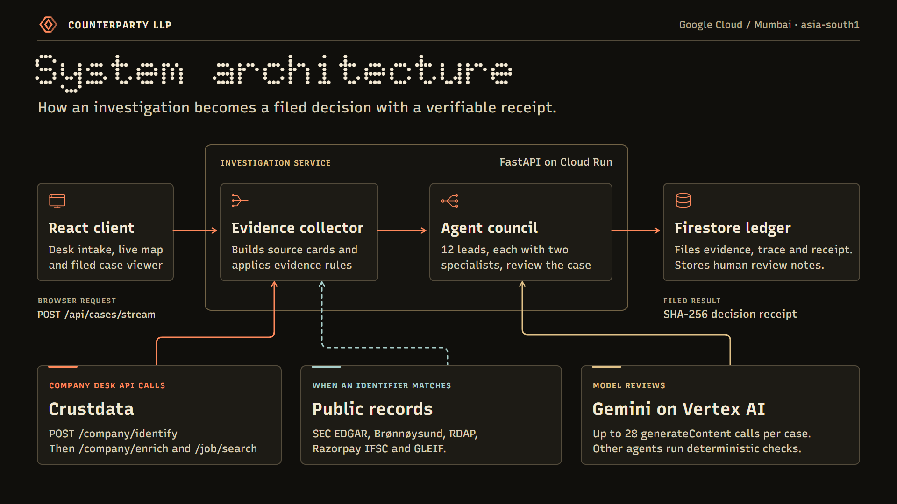

# System architecture

| **System architecture** | [User flow →](user-flow.md) |
| --- | --- |

[Presentation PNG · 1920 × 1080](diagrams/system-architecture.png) · [Editable vector diagram](diagrams/system-architecture.svg)

Counterparty runs the React workspace and FastAPI application on one Cloud Run service in Mumbai. The browser talks to that service. FastAPI holds the provider credentials, makes outbound calls and streams progress back to the browser. The hosted ledger uses Firestore. A local checkout uses SQLite by default. [Server entry point](../backend/main.py) · [Storage implementation](../backend/storage.py)

## Follow one Company investigation

| Stage | What happens |
| --- | --- |
| **1. Accept the case** | The browser sends a subject, desk and identifiers to `POST /api/cases/stream`. The response carries newline-delimited JSON. An API client can use `POST /api/cases` for the same investigation in a single response. [Stream client](../web/src/streamCase.js) |
| **2. Collect records** | The backend sends a domain or company name to Crustdata. One match scoring at least 0.8 with an integer company ID unlocks enrichment and a job search. With an SEC identifier it can also fetch a filing record. Ambiguous identity and unavailable sources remain visible. [Collector](../backend/live.py) · [Public identifier lookup](../backend/identity.py) |
| **3. Test the claim** | The engine turns provider rows into dated evidence cards, keeps source references and applies desk-specific rules to propose a finding. Several cards can share one original source. [Findings](../backend/findings.py) · [Verdict rules](../backend/adjudication.py) |
| **4. Challenge the finding** | Identity, discovery, challenge and decision are four groups within one process. Each of the 12 leads receives two specialist reports. Five dependency stages allow independent checks to run in parallel. Five leads and 23 specialists can call Gemini. The other checks use code, including calendar arithmetic. A referral can send an actionable finding to partner review. [Dependency graph](../backend/swarm.py) · [Personas](../backend/personas.py) |
| **5. File and return** | FastAPI creates a salted SHA-256 commitment and saves the case, evidence, reports and trace before emitting the final `case` event. Human review entries are stored separately, so adding a note preserves the original receipt. [Filing](../backend/main.py) · [Receipt](../backend/receipts.py) |

## Which external APIs run?

The desk, identifiers and consent determine which calls run. Crustdata collection uses `https://api.crustdata.com`. Where available, the server reads the actual charge from `X-Credits-Used`. [Crustdata adapter](../backend/providers.py) · [Estate search](../backend/estate.py)

| Source | Outbound calls | When the application uses them |
| --- | --- | --- |
| **Crustdata company and jobs** | `POST /company/identify`, `POST /company/enrich`, `POST /job/search` | Match company identity, retrieve company data and, for a matched Company desk case, request the latest indexed job posting. |
| **Crustdata people** | `POST /person/identify`, `POST /person/enrich`, `POST /person/search` | A consented profile lookup supplies employment history. Candidate can search for an employer-specific colleague sample. Estate uses a separate paginated cohort search after matching the bankrupt entity and publishes grouped movement. |
| **SEC EDGAR** | `GET /files/company_tickers.json` on www.sec.gov and `GET /submissions/CIK{10-digit-cik}.json` on data.sec.gov | Resolve an issuer when needed, then examine dated 8-K items, including 5.02 and 4.01. Requires the configured SEC contact header. |
| **Brønnøysund** | `GET /enhetsregisteret/api/enheter`, `…/enheter/{orgnr}`, `…/enheter/{orgnr}/roller` | Resolve Norwegian companies and inspect bankruptcy status, entity dates and registered roles. |
| **RDAP, Razorpay IFSC and GLEIF** | Registry `GET …/domain/{domain}`, `GET ifsc.razorpay.com/{code}`, `GET api.gleif.org/api/v1/lei-records/{lei}` | Look up a supported payment sender domain, an Indian bank branch or a legal entity when a suitable identifier is available. |
| **Gemini on Vertex AI** | `POST …/projects/{project}/locations/{location}/publishers/google/models/{model}:generateContent` | The council sends its assignment and selected case context using Google Application Default Credentials. The server validates returned evidence references. A failed upstream review can block dependent model work. [Vertex client](../backend/drafting.py) |

## What a reviewer can read later

| Browser action | Internal API | Data returned |
| --- | --- | --- |
| Open a map or a filed case | `GET /api/swarms/{desk}`, `GET /api/cases`, `GET /api/cases/{id}` | Roster, shared live-case ledger, saved evidence and agent handoffs |
| Check a receipt or add follow-up | `GET /api/cases/{id}/receipt`, `GET` or `POST /api/cases/{id}/reviews` | Verification status and a separate, append-only human review log |
| Inspect the provider account | `GET /api/capabilities` | Reads Crustdata `GET /account/endpoints` and `GET /account/credits` for the cached account card. [Account client](../backend/account.py) |
| Inspect the configured company watch | `GET /api/watch` | Reads Crustdata `GET /watch/company/{id}` and `GET /watch/company/{id}/runs`. Checking history is a separate action from starting a case. [Watch client](../backend/watch_history.py) |

A configured watch can also deliver a signed callback to `POST /watch/webhook`. With Pub/Sub delivery enabled, an authenticated push to `POST /watch/pubsub` flags a bound case for review. Ordinary filing produces a local receipt. Public Sigstore timestamping requires separate signing configuration. The optional BigQuery batch cache sits outside the investigation path. [Watch receiver](../backend/watch.py) · [Cloud setup and receipt options](../cloud/README.md)
