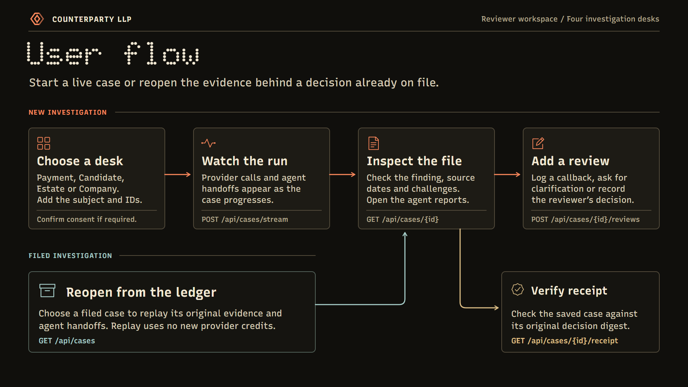

# User flow

| [← System architecture](system-architecture.md) | **User flow** |
| --- | --- |

[Presentation PNG · 1920 × 1080](diagrams/user-flow.png) · [Editable vector diagram](diagrams/user-flow.svg)

A reviewer opens an investigation, watches evidence arrive, inspects the finding and records the next human action. A filed case preserves the observations from that run. Reopening it does not collect fresh evidence or spend provider credits.

## Choose a question

The home page opens on the **Swarm map**. Select an agent to inspect its assignment and handoffs, or use **Find** to search the roster. Choose **Open an investigation** to reach the inspector’s **Run** tab. Under **Desks**, entering a field highlights the provider it can call. Submitting the form starts collection. [Map and inspector](../web/src/swarm/SwarmAtlas.jsx) · [Desk intake](../web/src/components/DeskStudio.jsx)

| Desk | Reviewer supplies | Which sources the reviewer can see |
| --- | --- | --- |
| **Payment** | Vendor name and available vendor domain, sender domain, contact profile, Norwegian registry number or Indian bank IFSC | Crustdata company and consented person records, RDAP domain dates, Brønnøysund records and IFSC branch metadata. |
| **Candidate** | Subject, profile URL, employer domain, employment claim and consent | Crustdata Person Identify and Enrich for employment history, Person Search for colleague overlap, and Company Enrich for dated headcount. |
| **Estate** | Company name and available domain or Norwegian organisation number | Brønnøysund bankruptcy and role records, Crustdata company identity and a paginated Person Search for grouped workforce movement. |
| **Company** | Company name and available domain, LEI, SEC CIK or investigation question | Crustdata Company Identify, Company Enrich and Job Search, plus issuer filings from SEC EDGAR or a GLEIF record where an identifier resolves. |

Candidate checks require consent. Payment intake also requires consent when a contact profile is supplied. The intake shows estimated Crustdata credits and up to 28 Gemini reviews. New submissions run live and can incur provider charges. [Field definitions](../web/src/desks.js)

## Follow the live investigation

The browser posts the selected desk, subject, inputs and consent to `POST /api/cases/stream`. The response is newline-delimited JSON. `step` events update collection and agent activity, a `case` event carries the filed result, and an `error` event exposes a failed run. The map’s **Trace** tab shows activity while the desk form and Live investigation room show provider progress. [Stream client](../web/src/streamCase.js) · [Server lifecycle](../backend/main.py)

Company identification precedes enrichment. One qualifying match with confidence of at least 0.8 and an integer company ID unlocks enrichment and, for the Company desk, job search. If multiple candidates qualify, the reviewer can inspect the identity finding and supply a more precise identifier in a new investigation. [Collection boundary](../backend/live.py)

Evidence passes through identity, discovery, challenge and decision. Leads and their paired specialists file reports with source references. A referral for more evidence can move an otherwise actionable proposed finding to **PARTNER REVIEW**. Multiple cards from one provider do not establish independent witnesses. [Council and filing](../backend/main.py)

## Read the result and choose the next action

The filed result shows the verdict, summary, available drafting note, specialist referrals, steps, evidence dates, source links, credits and receipt. Expand a source card to see who supplied the observation and when. Estate flows suppress destination groups smaller than five people. [Case file](../web/src/components/CaseFile.jsx)

The home-page **Ledger** filters filed live cases by desk. Selecting a subject calls `GET /api/cases/{id}` and reopens the case file. **Copy digest** copies its receipt, while **Verify receipt** calls `GET /api/cases/{id}/receipt` and displays the verification status. [Ledger](../web/src/components/Ledger.jsx) · [API client](../web/src/api.js)

For follow-up, open **Workspace → Discussion room** and choose the filed case. Read the two specialist reports under each lead. **Human review** accepts a note of up to 800 characters with **Callback requested**, **Clarification requested**, **Evidence corrected** or **Review complete** through `POST /api/cases/{id}/reviews`. Existing entries load from the same path with `GET`. [Discussion room](../web/src/DiscussionRoom.jsx) · [Review form](../web/src/HumanReview.jsx)

## Reopen and replay

Use **Inspect swarm trace**, the discussion room’s inspector link or the map’s **Filed investigation** selector to open stored reports. A `?case={id}#swarm` link selects the saved case and its desk. **Replay handoffs** advances the recorded events through the map without another provider run. Older cases without agent tracing still expose their filed evidence. [Recorded trace handling](../web/src/swarm/SwarmAtlas.jsx)

Other workspace tabs provide focused views. **Live investigation** runs another case, **Provider room** reads company watch history and account capabilities, and **Filed estates** reopens live Estate cases. [Workspace navigation](../web/src/workspace.jsx) · [Provider room](../web/src/ProviderRoom.jsx) · [Estate archive](../web/src/EstateArchive.jsx)

## When the answer is incomplete

An unresolved identity, unavailable provider or missing independent witness remains visible in the filed steps and evidence. **INSUFFICIENT WITNESSES** tells the reviewer that the available sources could not independently establish the claim. If the stream closes before a filed case arrives, check the ledger before retrying. The server may finish after the browser disconnects. [Streaming and persistence](../backend/main.py) · [Client interruption handling](../web/src/streamCase.js)

## A completed case to follow

The Company desk used **2.23 Crustdata credits** to file six evidence cards about Crustdata itself. They traced back to one provider, and the verdict was **Insufficient witnesses**. Open the trace, select **Scope analyst** and inspect its two specialist reports and citations. The receipt verifies the file that contains those observations. [Open the filed investigation](https://counterparty-939419364980.asia-south1.run.app/?case=c4b983b065f7413daaf908c9ab06f9a6#swarm) · [Verify its receipt](https://counterparty-939419364980.asia-south1.run.app/api/cases/c4b983b065f7413daaf908c9ab06f9a6/receipt)
